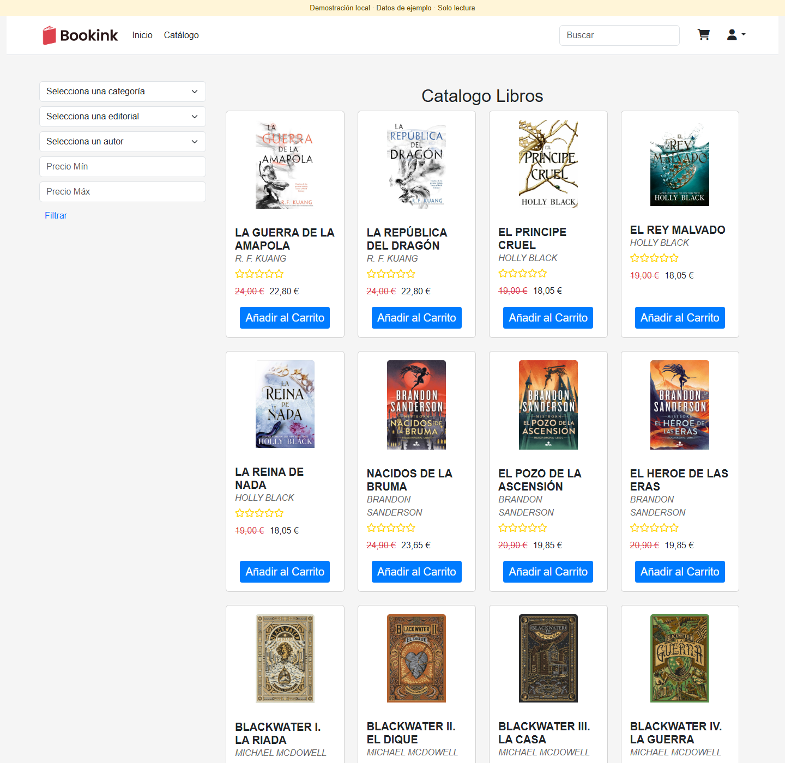
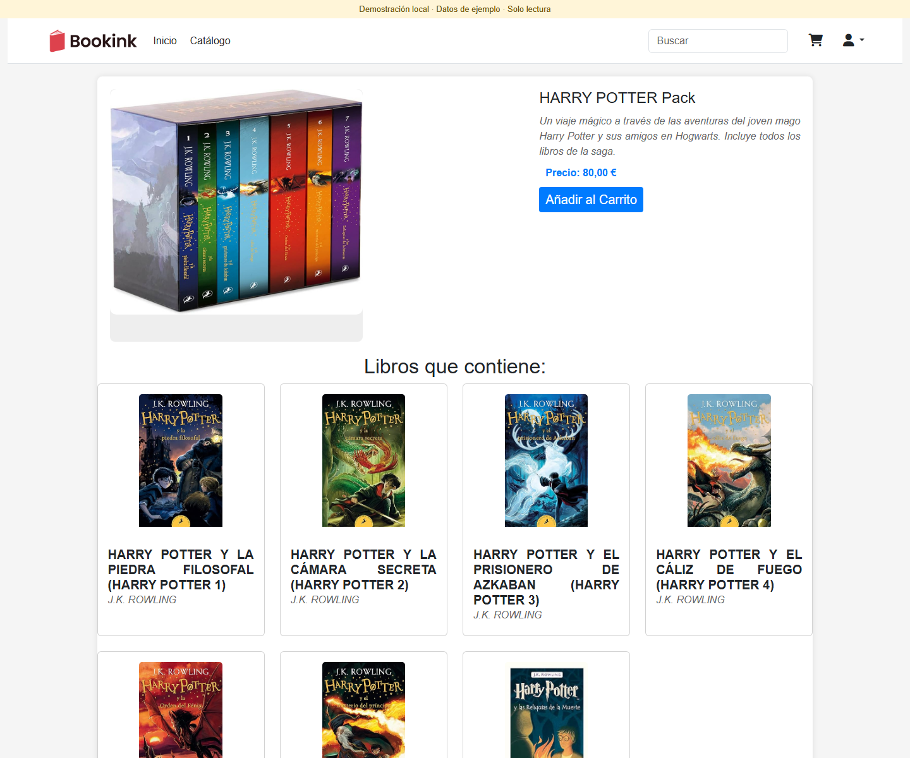
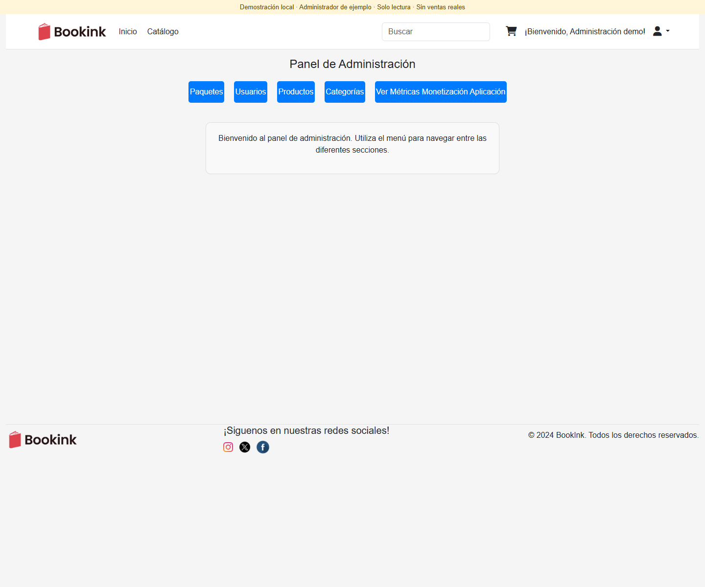
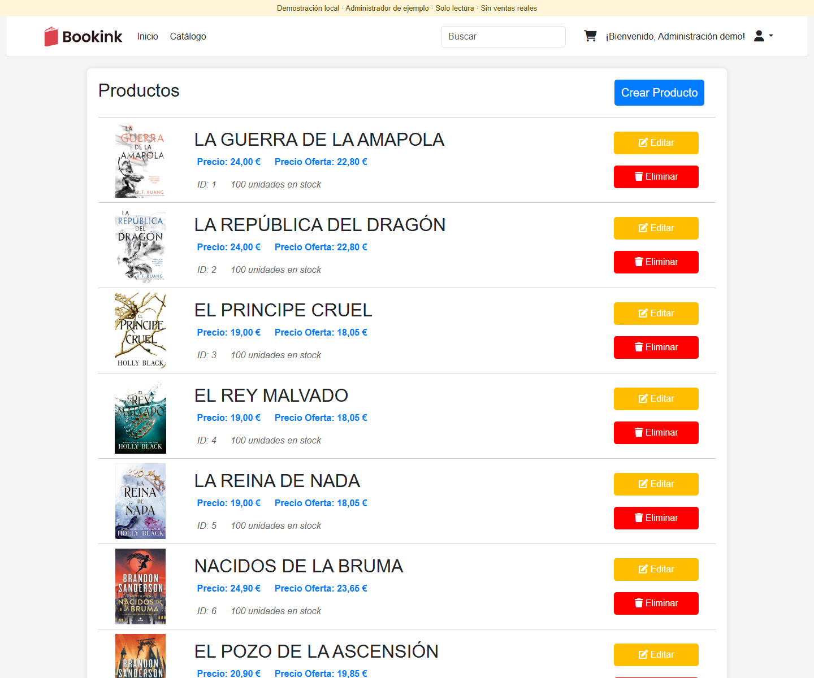
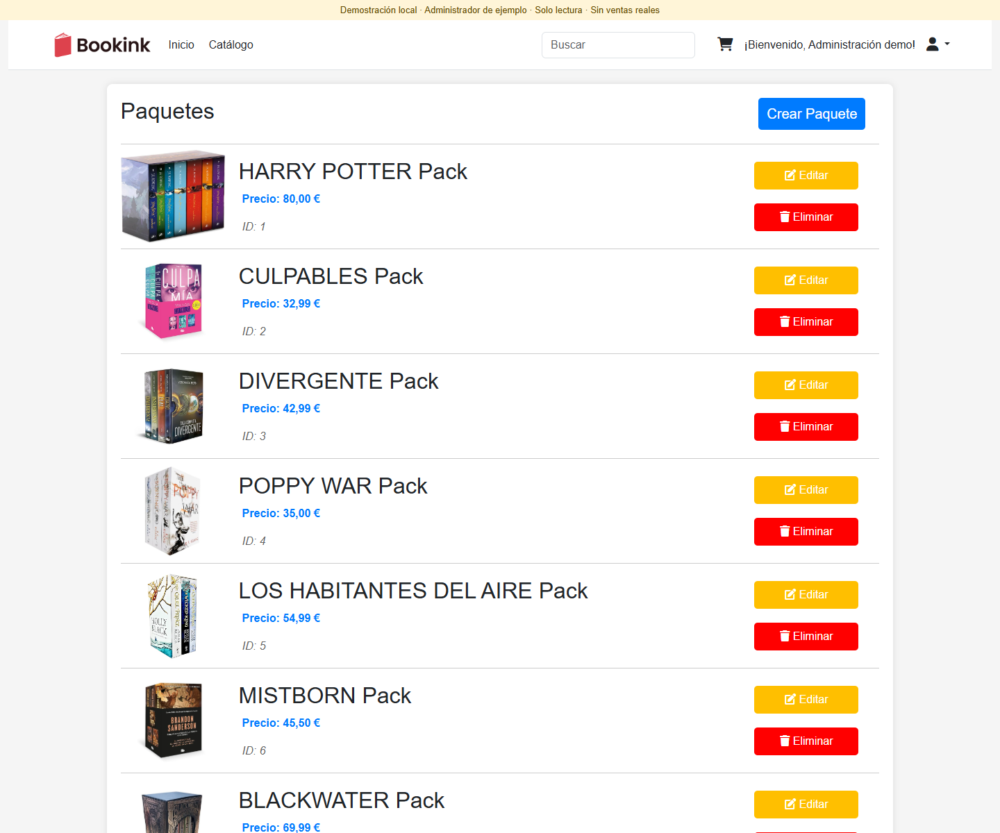
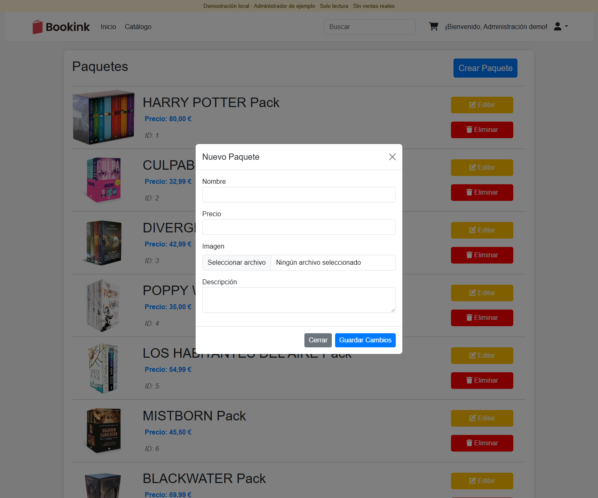
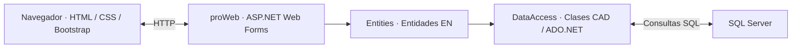
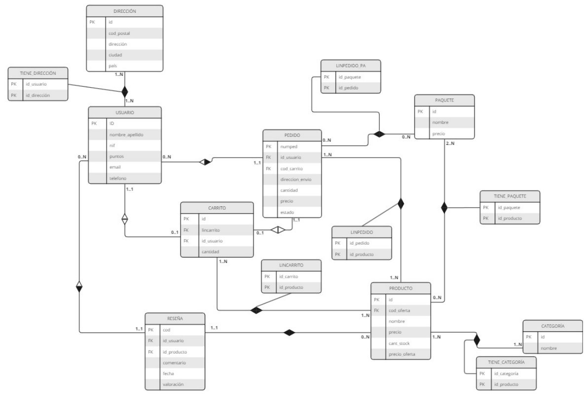

<div align="center">

# LibroExpress · Bookink

### Una librería online desarrollada en C# y ASP.NET Web Forms

Catálogo de libros · Paquetes de lectura · Carrito y pedidos · Administración

**C# · .NET Framework 4.7.2 · ASP.NET Web Forms · SQL Server · ADO.NET · Bootstrap**

[Arquitectura](#arquitectura) · [Ejecución local](docs/EJECUCION.md) · [Equipo](#equipo-y-contribuciones)


</div>

## El proyecto

LibroExpress, presentado en la interfaz como **Bookink**, es un proyecto académico en equipo del curso 2023/2024 de la asignatura **Herramientas Avanzadas para el Desarrollo de Aplicaciones (HADA)** de la Universidad de Alicante.

La aplicación organiza una tienda de libros en tres áreas: navegación pública, operaciones de clientes registrados y gestión administrativa. La lógica de negocio y el acceso a SQL Server se separan de las páginas Web Forms mediante entidades EN y clases de acceso a datos CAD.

La imagen de portada es un recurso gráfico original de la aplicación.

## Vistas de la aplicación

<table>
  <tr>
    <td align="center"><a href="docs/screenshots/portada.png"></a></td>
    <td align="center"><a href="docs/screenshots/catalogo.png"></a></td>
  </tr>
  <tr><td align="center">Portada y novedades</td><td align="center">Catálogo de libros</td></tr>
  <tr>
    <td align="center"><a href="docs/screenshots/libro.png"></a></td>
    <td align="center"><a href="docs/screenshots/paquete.png"></a></td>
  </tr>
  <tr><td align="center">Ficha de libro</td><td align="center">Paquete de lectura</td></tr>
</table>

Interfaz original ejecutada localmente con IIS Express en una demostración de solo lectura, con datos del catálogo de ejemplo. Las selecciones de productos no representan ventas reales; las capturas no validan el proceso de compra ni la conexión histórica a SQL Server. Pulsa sobre una imagen para ampliarla.

Otras pantallas: [inicio de sesión](docs/screenshots/acceso.png) · [registro](docs/screenshots/registro.png).

### Administración

<table>
  <tr>
    <td align="center"><a href="docs/screenshots/admin-panel.png"></a></td>
    <td align="center"><a href="docs/screenshots/admin-productos.png"></a></td>
  </tr>
  <tr><td align="center">Panel de administración</td><td align="center">Gestión de productos</td></tr>
  <tr>
    <td align="center"><a href="docs/screenshots/admin-paquetes.png"></a></td>
    <td align="center"><a href="docs/screenshots/admin-crear-paquete.png"></a></td>
  </tr>
  <tr><td align="center">Gestión de paquetes</td><td align="center">Formulario de creación de paquetes</td></tr>
</table>

Las vistas administrativas se muestran con una cuenta y datos de ejemplo en una copia local de solo lectura. Los formularios se pueden visualizar, pero las operaciones de creación, edición y borrado están bloqueadas en esa demostración. Estas capturas no validan el acceso administrativo ni la persistencia sobre la base de datos original.

Más vistas: [categorías](docs/screenshots/admin-categorias.png) · [usuarios de ejemplo](docs/screenshots/admin-usuarios.png).

## Funcionalidades

| Área | Funcionalidades incluidas |
| --- | --- |
| Catálogo | Libros, fichas de producto, búsqueda y filtros por nombre, categoría, autor, editorial y precio. |
| Paquetes | Agrupaciones de libros, consulta de sus productos y administración de paquetes. |
| Clientes | Registro, acceso, perfil y direcciones. |
| Compra | Carrito, líneas de pedido y consulta del historial de pedidos. |
| Administración | Gestión de productos, categorías, paquetes y usuarios. |
| Métricas | Consultas de ventas y visualización de su evolución. |

Es un prototipo académico; el flujo de pedido no constituye una integración con una pasarela bancaria real.

## Arquitectura



| Capa | Responsabilidad |
| --- | --- |
| `proWeb/` | Páginas ASPX, formularios, navegación compartida y presentación. |
| `ClassLibrary/Entities/` | Entidades de negocio: productos, paquetes, usuarios, carrito y pedidos. |
| `ClassLibrary/DataAccess/` | Acceso a los datos y operaciones de persistencia. |
| `database/` | Esquema relacional y catálogo de ejemplo sin cuentas personales. |

## Equipo y contribuciones

Proyecto académico desarrollado en grupo para HADA, Universidad de Alicante. El reparto siguiente recoge las responsabilidades documentadas en la entrega original.

**Aitana Cantó Rico** coordinó el equipo y gestionó las integraciones en GitHub, el seguimiento del flujo de trabajo y la resolución de conflictos.

| Integrante | Entidades y acceso a datos | Páginas y contribuciones |
| --- | --- | --- |
| **Aitana Cantó Rico** | Paquetes y relaciones entre paquetes y productos. | Paquetes, administración de paquetes, Site.Master, datos iniciales, filtrado y colaboraciones en portada y catálogo. |
| **Rafael Carballo Lorenzo** | Pedidos y líneas de pedido de paquetes. | Pedido, confirmación, historial, base de datos y evolución de ventas. |
| **Bruno Vilella Martínez** | Carrito y líneas de carrito. | Carrito, base de datos, ventas por categoría y colaboraciones en productos y catálogo. |
| **Darío Pastor Fuentes** | Productos y líneas de pedido. | Portada, producto, administración de productos y despliegue de la entrega académica. |
| **Alberto Boronat López** | Categorías y relaciones con productos. | Administración de categorías, métricas y recursos gráficos de libros. |
| **Manuel José Tornero Fuster** | Usuarios y reseñas. | Acceso, registro y colaboraciones en perfil, reseñas, administración y métricas. |
| **Jorge Paredes Soler** | Direcciones y relaciones con usuarios. | Perfil, administración de usuarios y estilos de sus páginas. |

Las colaboraciones se presentan como trabajo conjunto; el reparto no implica autoría exclusiva de cada archivo.

## Modelo de datos



[Abrir el diagrama en PDF](docs/database/modelo-relacional.pdf) · [Esquema SQL](database/01-schema.sql) · [Catálogo de ejemplo](database/02-catalogo.sql)

## Estructura del repositorio

```text
libroExpress.sln         Solución de Visual Studio
ClassLibrary/
  Entities/             Entidades de negocio
  DataAccess/           Acceso a datos
  Properties/           Metadatos del proyecto
proWeb/
  content/              Estilos, imágenes y portadas de libros
  Properties/           Metadatos del proyecto web
  *.aspx                Páginas de la tienda
  Site.Master           Diseño y navegación compartidos
  Web.config            Configuración web sin credenciales
database/
  01-schema.sql         Tablas y relaciones
  02-catalogo.sql        Productos, categorías y paquetes de ejemplo
docs/
  database/             Diagramas originales
  images/               Recursos visuales del proyecto
  screenshots/          Vistas de la tienda y administración
  EJECUCION.md          Preparación del entorno local
```

## Ejecutar en local

Abre `libroExpress.sln` con Visual Studio y configura `proWeb` como proyecto de inicio. La solución utiliza **.NET Framework 4.7.2 y SQL Server**; no es una aplicación ASP.NET Core.

La [guía de ejecución](docs/EJECUCION.md) explica los requisitos, la preparación de una base de datos propia y la configuración local. No se necesitan las credenciales del servidor usado durante la asignatura.
